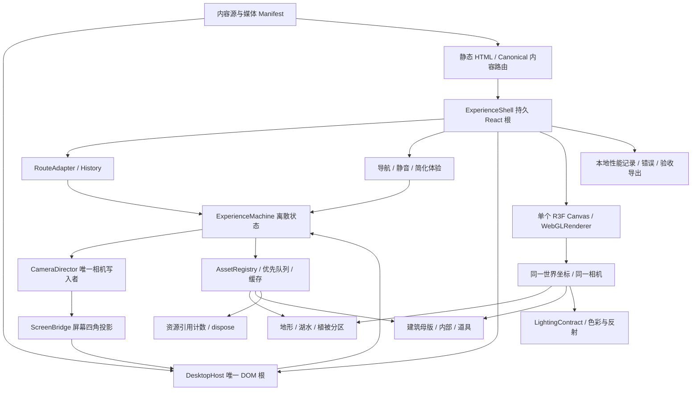

# 02 · 技术架构与状态合同

除标注 [F] 的外部能力外，本页为 [E] 待实施架构。依赖的实际版本在 Phase 01 锁定并保存 lockfile，不把本轮读取的开发分支自动当作生产依赖。

## 1. 选择与模块图

Three.js WebGLRenderer / WebGL2 为首版基线；React + TypeScript 管理内容和桌面，R3F 管理一个长期存在的 Canvas。WebGPU 是后续独立渲染后端候选，不在首版同时维护两套 shader。采用 Vite 构建客户端；内容路由在构建期生成独立 HTML 和 JSON，可静态托管。首版不需要个人资料数据库或外部 API。

架构选择不意味着开始开发。上图中的模块均为后续计划。

| 模块 | 负责 | 明确不负责 / 接口约束 |
| --- | --- | --- |
| ExperienceMachine | 当前空间、目标、资源 readiness、过渡 token、最近安全节点 | 不存每帧 Vector3，不直接操作 DOM 和材质 |
| CameraDirector | 相机 pose、路径、弧长 / 速度、控制权、恢复快照 | 不打开窗口、不读取文章内容；唯一写入相机的模块 |
| World / SceneRegistry | 持久场景根、chunk 显隐、共享坐标、碰撞代理 | 不把路由变化映射成整个 Canvas 重建 |
| AssetRegistry | Manifest、下载 / 解码 / 上传阶段、依赖优先级、引用计数 | readiness 不能仅用网络下载完成定义 |
| LightingContract | 太阳、光图、环境探针、曝光和输出链 | 不让各组件私自添加全局补光 |
| ScreenBridge | 屏幕网格锚点、四角投影、DOM transform、切换确认 | 不持有窗口内容，不捕获任意 DOM 生成实时纹理 |
| DesktopManager | AppRegistry、窗口状态、焦点、应用生命周期 | 不直接修改 Three.js camera；只派发 ENTER / EXIT 命令 |
| ContentRepository | Notes / Photos / Projects / Resume 的 schema、slug 和静态数据 | 3D 对内容可见性没有最终控制权 |
| RouteAdapter | URL ↔ 语义状态、popstate、刷新恢复 | 不把每一帧进度或每次拖窗口写进 history |
| ResourceLedger / Telemetry | GPU / 媒体资源归属、测量、错误和验收证据 | 不默认把访问者数据发送到第三方 |

用类型化命令和事件联结模块，例如 requestNavigation(target)、resourcesReady(group,revision)、transitionSettled(token)、desktopExited(snapshot)。React 只订阅离散状态；位置、uniform 与投影矩阵在帧循环内部更新，避免 60Hz 全局 React 渲染。

## 2. 一个 Canvas 与两个空间

室外、建筑壳体和室内处于同一世界坐标，同一相机穿过真实门洞。采用一个 Scene 下的分组；不通过分别挂载两个 Canvas 假装连续。建筑门窗属于共享母版，只渲染一份壳体，避免共面墙闪烁。

室内在门外不可见的高细节可晚挂载，但所有能透过窗 / 门看见的对象必须先有正确代理。进入室内后仍保留窗口视锥所需的湖、树、山与反射代理；不能把室外 group 全部隐藏。室外低质量代理与高质量内部材质切换，只能在不可见分区或经过同镜头匹配的遮挡处发生。

内容路由和桌面应用位于 Canvas 外，不能把文章导航作为 Canvas 的 React key。WebGL context lost 时可重建 GPU 资源，React 桌面、URL 和内容状态仍能存活。

## 3. 状态机与可打断行为

空间状态：BOOT、OUTDOOR、APPROACH、ENTRY、INDOOR、SCREEN_APPROACH、SCREEN_DOCK、DESKTOP、SCREEN_UNDOCK、EXIT、CONTENT_ONLY、RECOVERING。加载、质量、声音是并行子状态，不用枚举数十个空间 × 网络 × 档位组合。

| 当前 → 目标 | 事件 / 前置守卫 | 动作 | 失败与中断 |
| --- | --- | --- | --- |
| BOOT → OUTDOOR | renderer 可用；最小室外集可见、shader 预热完成 | 展示 S01，开放有限观察 | 失败进 CONTENT_ONLY；不无限转圈 |
| OUTDOOR → APPROACH | 点击木屋；接近路径基础资源 ready | 保存户外 pose；预取室内 / 电脑 | Escape 从当前 pose 回安全户外节点 |
| APPROACH → ENTRY | 门洞、室内、窗外最低质量集均 ready | 门打开 / 预先开启；执行门槛段 | 不 ready 则停门廊安全节点；显示真实加载状态 |
| ENTRY → INDOOR | 镜头到达室内锚点 | 收紧观察体积；记录室内 pose | 门框内不允许用户拖相机穿墙；可请求沿安全路径返回 |
| INDOOR → SCREEN_APPROACH | 点击电脑；DesktopRoot 初始化完成 | 保存室内 pose 和 FOV，推进到 S04 | Escape 从当前 pose 平滑回桌边安全节点 |
| SCREEN_APPROACH → SCREEN_DOCK | 正面屏幕锚点可见、布局 / 字体 ready | 计算四角映射，准备 DOM 接管 | resize 重新计算；校准失败退回 S04，不展示双屏 |
| SCREEN_DOCK → DESKTOP | DOM 四角和纹理匹配、过渡 settled | 开放 DOM 输入；暂停 3D 渲染 | 过期 token 不可夺走焦点；失败留室内 |
| DESKTOP → SCREEN_UNDOCK | 返回木屋 | 保存窗口 / 内容状态；3D 首帧就绪后还原屏幕映射 | context 不可恢复时继续 DOM，允许直接内容访问 |
| SCREEN_UNDOCK → INDOOR | DOM 重新贴回电脑并淡出完成 | 恢复室内 pose，再开放观察 | 不能把旧相机快照应用到新宽高比 |
| INDOOR → EXIT → OUTDOOR | 点击门 / 返回湖岸，沿安全逆向路径 | 恢复外景并保留室内热缓存一段时间 | 加载失败停安全节点；可切内容模式 |
| 任意 → CONTENT_ONLY | 用户选择简化 / WebGL 不可用 | 同一内容数据以普通 DOM 可访问 | 无 WebGL 也能分享 URL |
| 任意 3D → RECOVERING | context lost | 暂停时钟、输入与音频，保留语义快照 | 一次受控恢复失败后给重试和内容入口 |
| 任意 → 语义目的地 | popstate / 刷新 | 解析 route，取消旧 token，安全加载目标 | 不恢复“飞到 43%”这种中间态 |

中断合同：导航产生递增 transitionId；新任务使旧回调失效。保存实际当前 position / quaternion / FOV / look target，取消旧插值，再规划到安全节点；不能假设把曲线参数倒过来就能从任意 pose 连续返回。到达只有一次 commit，取消也只有一次结算；镜头与资源的异步完成不能各自更新空间状态。

[F] 当前读取的 [camera-controls stop() 源码](https://github.com/yomotsu/camera-controls/blob/c51601107e266097edf6a9caa57bfa9eaa77427c/src/CameraControls.ts#L2529) 把当前内部量复制为终点量；不能直接当“停在当前屏幕姿态”。项目需在外层保存实际 pose，禁用控件，再以无过渡 setLookAt 同步当前 pose。其 rest Promise 不包含本项目的取消 / 资源回滚合同，须用 token 与超时包装。

## 4. LOD、预加载与首屏

Manifest 每个包包含 id、hash、bounds、依赖、最低质量代理、字节数、几何与纹理预算、许可和 dispose owner。阶段定义为 FETCHED → DECODED → ATTACHED → GPU_READY，前两阶段不能作为“可以飞入”的依据。

1. P0：HTML、内容入口、原创轻量 poster 与关键交互代码。内容不依赖 3D 下载。
2. P1：S01 的可见地形、木屋外壳、实时水、选定近景树石、天空与压缩纹理。先形成完整构图，再细化。
3. P2：后台预取 S02 / 门口区；hover、键盘 focus 或点击木屋提升室内优先级。触屏不依赖 hover。
4. P3：室内光图 / PBR、电脑、DesktopRoot 字体和图标。在门廊前完成解码与首个 GPU 上传；不能把大纹理上传留到进门瞬间。
5. P4：Photos、项目媒体按应用打开和可见项按需加载。首次访问不下载全部高分照片。

地形按 chunk，植被按物种 × 空间块 × LOD 实例化；避免整个森林一个巨大的 InstancedMesh 导致剔除失效。初始近 / 中 / 远界限约 25 / 100 / 300m，随投影误差和镜头调节；树干、叶片、阴影使用独立质量策略。切换加入约 15% 距离滞后；dither 若引入闪烁则改用遮挡切换 / 几何一致 LOD。远山用轻网格或分层投影，不能把有明显平移视差的整片近森林画在全景球上。

并发下载与解码队列要分开；优先级可提升，过时响应不得 attach。AbortController 只保证可取消的请求链，GLTFLoader / worker / GPU 上传仍须处理迟到结果并释放。缓存以 hash 寻址，预算受 06 约束。

## 5. 光照分工与水体

首版固定太阳和室内布局；不承诺随开关窗帘重算 GI。建议把静态 diffuse irradiance 分为：天空直射与间接贡献 + 太阳的间接反弹；**太阳直接照明与阴影只由实时 DirectionalLight 提供**。烘焙时不乘 BaseColor，避免材质重复着色。

烘焙对象的运行时环境需保留 specular IBL，而不要再叠加同一份天空 diffuse IBL / AmbientLight。标准材质没有一个可无脑复制的“只关 diffuse IBL、保留 specular”项目开关；需要锁版本的 MaterialAdapter 并做灰卡、白墙、金属球校准。若未通过，回退为已校准的 SUN-free ambient 光图 + 实时 SUN，记录太阳间接反弹缺失，不能把错误能量通过降低曝光掩盖。SUN-free 只解决太阳 direct 重复的一部分问题，回退仍须消除重复天空 diffuse；若材质适配或能量校准仍失败，不能进入整屋生产，须继续修复或按 07 比较 B1 静态外观方案。plugin-interior 的 SUN-free 流程是参考，不是证明本项目已完成能量校准。

[F] [plugin-interior pipeline](https://github.com/img2threejs/plugin-interior/blob/f2c3667bb6d3bacfc9e38898a7516d47bc2e90b1/authoring/pipeline.py#L375) 有 SUN-free ambient bake 和光图强度约定；[浏览器光图准备](https://github.com/img2threejs/plugin-interior/blob/f2c3667bb6d3bacfc9e38898a7516d47bc2e90b1/runtime/viewer/src/interior-lightmaps.js) 专门处理其 r180 EXR / UV 通道边界。不要把该翻行与 PI 值无条件移植到其他 Loader / 导出版本。

水优先采用 planar reflection + 小幅顶点波 / 多尺度法线 + 深度相关吸收与浅岸过渡。镜面相机、可见性列表和主相机共享世界，不每帧更新六面 cubemap。Water.js 是镜面投影机制参考，不提供本项目完整折射和湖岸光学。反射使用简化场景层、低分辨率与可调刷新；动水时保证反射变化足够稳定。若使用反射缓存，镜头快速运动期间提高更新，停止后降低频率，实测是否产生拖影。

WebGPU 后端需重写 / 适配上述自定义 ShaderMaterial；[官方 Water](https://threejs.org/docs/pages/Water.html) 当前明确仅适配 WebGLRenderer，WebGPU 使用不同 WaterMesh。不得依赖自动 fallback 覆盖所有自定义 shader。

## 6. 电脑屏幕进入全屏 DOM

选择 **一个长期挂载的 DesktopRoot + 一个稳定的 DesktopHost**。远处电脑屏幕使用原创静态预览纹理；进入 S04 后才以同一数据状态显示 DOM。浏览器不能把任意复杂 DOM 免费、无损地实时当成 WebGL 纹理，方案不依赖这种假设。

切换顺序：

1. ScreenAnchor 来自 GLB 的屏幕有效区域四个顶点，包含屏幕倾角、父级变换与真实宽高，不通过手调 CSS 猜位置。
2. 镜头沿屏幕法线接近，停在可匹配姿态；DesktopRoot 的初始预览状态、虚拟分辨率与纹理一致。输入保持锁定。
3. 逐帧把四角 world → camera → NDC → CSS viewport，求矩形到屏幕四边形的 projective transform（CSS matrix3d）；复杂遮挡由屏幕可见性检测决定，前段只用 3D 预览。
4. 四角误差通过后，DOM 与屏幕预览做短暂重叠淡入；预览材质不再重复显示。DOM 不走场景 Tone Mapping；预览也按同一 sRGB 输出校准。
5. 把 DOM 四边形平滑展开到视口矩形。宽高比不同时采用先保留比例 / letterbox 再明确的布局展开，窗口随容器尺寸平滑 reflow；不通过拉伸文字假装匹配。仍使用同一个 React 根、窗口 store 和内容实例。
6. 首次有效布局与字体加载完成后才释放键鼠焦点，触发 transitionSettled。此时可以暂停 Canvas 帧循环，保留 GPU 热资源。

退出反向执行，但必须先预热并渲染正确的 3D 首帧；将当前桌面状态贴回屏幕后才拉远。记录 ScreenAnchor、viewport、相机 pose / FOV、窗口 store revision 和内容 slug，resize 后重新计算几何，不能复用旧像素矩阵。电脑屏幕画面在恢复时可保持 DOM 直到离开可读距离，再切成同状态的简单预览；复杂内容无需远景逐像素复刻。

[H] CSS projective transform、DPR、浏览器文字栅格与宽高比变化能否在目标硬件满足角点 ≤2 CSS px 和无明显亮度跳变，须在 Phase 03 验证。若失败，采用正对屏幕的短距离遮罩淡入与同色背景展开；保留空间动作与可逆状态，不能宣称已实现像素级无缝。

[F] [pmndrs Html 示例](https://github.com/pmndrs/examples/blob/541599ac5ad913de85796403c1c6927ada3b303c/examples/mixing-html-and-webgl/src/App.tsx) 演示 transform / occlude 及 DOM 交互禁用 OrbitControls。可借其定位机制，但它不包含本项目的全屏切换、焦点和窗口恢复合同。

## 7. React 桌面与内容可访问性

AppRegistry 初始仅 Notes、Photos、Projects、Resume，包含 appId、title、原创 icon、lazy component、singleInstance、默认与最小尺寸。每个应用有 create / activate / suspend / resume / dispose 生命周期；最小化不等于关闭，关闭不销毁共享内容数据。窗口维护 id、rect、restoreRect、z-order、minimized、maximized、activeContentId。pointer capture、键盘焦点和屏幕边界都由窗口层管理。

ThanasOS 可参考 Dock 放大、窗口移动 / 缩放、AppConfig。需要补充真实内容 URL、Photo 查看器、Resume、窗口序列化、错误隔离和键盘导航；不能复制其第三方壁纸、Apple 图标或网络代理功能。源码核查见 03。

路由合同：

| URL | 直达 / 刷新 | 从桌面打开 |
| --- | --- | --- |
| `/` | poster + 内容入口；加载完成进入湖岸 | 返回空间起点 |
| `/notes/`、`/notes/:slug/` | 可搜索的静态 HTML 正文与链接 | 激活 Notes 并显示同一内容 |
| `/photos/:id/` | 带 alt、版权和正文的照片页；当前为空态 | 打开 Photos，对应媒体按需加载 |
| `/projects/:slug/` | 项目详情 HTML；当前为空态 | 激活 Projects |
| `/resume/` | 语义化履历 HTML；当前为空态 | 激活 Resume |
| `?view=world&place=cabin` | 用户明确选择进入世界；资源 ready 后安全室内节点 | 不从中间动画恢复 |

静态生成内容和客户端内容共用 schema。使用 React renderToString + hydrateRoot 生成可增强入口，或让纯静态文章区域与客户端根明确分离；[renderToStaticMarkup](https://react.dev/reference/react-dom/server/renderToStaticMarkup) 的输出不能直接 hydrate，不能混用。每条内容路由产出真实文件与 canonical、title、description、OG / sitemap；不只写 SPA fallback 或 hash URL。实际部署路由规则留 Phase 06。

URL 记录语义内容，history.state / sessionStorage 记录当前会话的世界返回节点、窗口布局与版本。内容选择 pushState，拖拽 / focus 不增加历史项；popstate 单向更新状态、不再次 push。刷新后默认先展示直接内容，无须强制重播湖岸电影。存储损坏或被禁用时使用默认状态，URL 仍有效。浏览器 Back 和“返回木屋”是不同意图，后者显式跳回保存节点，不能盲调 history.back() 跳出本站。[History / popstate 依据](https://developer.mozilla.org/en-US/docs/Web/API/Window/popstate_event)。

## 8. 失败、可访问性与生命周期

加载错误按包显示重试（建议自动重试最多 2 次、带退避），保留已可用空间与内容；没有可靠 Content-Length 时不显示伪造百分比。解码 / shader 错误降级到已验证材质或质量档，均保留明确内容入口。

Reduced Motion：不强制飞行，使用短淡入 / 明确到达；关闭 idle motion、风动与景深拉焦。桌面提供键盘 Dock、窗口标题 / 关闭 / 返回按钮，焦点不能落入隐藏或 inert 场景。窄屏为全屏应用切换或内容模式，不把 1440px 桌面缩小到手机。

ResourceLedger 按 owner 记录 geometry、material、texture、RenderTarget、PMREM、loader worker、video、audio、事件和计时器；共享资源引用归零才释放。撤销 chunk 同时取消待加载 owner；迟到资源必须 dispose。不要在“返回室内”时 dispose 整个 renderer。

[F] 移除 Mesh 不会自动释放 GPU 资源，材质 dispose 也不释放共享纹理；ImageBitmap.close 和 RenderTarget.dispose 需分别处理，见 [Three.js disposal](https://threejs.org/manual/pages/how-to-dispose-of-objects.html)。媒体另需 pause、断开源 / AudioNode、撤销 object URL；页面隐藏时暂停时钟，恢复时重置 dt，避免飞行动画跳到末帧。

context lost：preventDefault 允许恢复，停止渲染，不抛弃桌面状态；恢复后按 Manifest 重建资源并校验有效 revision。多次失败提示“重新加载 3D / 继续浏览内容”。[MDN context 检测](https://developer.mozilla.org/en-US/docs/Web/API/WebGLRenderingContext/isContextLost)。

长期验证覆盖 20 次完整往返与 30 分钟停留，观察资源计数和估算显存是否进入平台期，不能要求 Three.js 内部缓存绝对归零；具体测量与失败线见 06。
