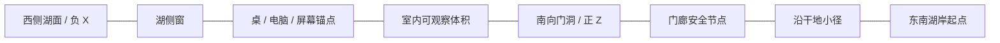

# 04 · 场景与摄影机实施规划

本页尺寸、路径、时间与阈值均为 [E] 初始设计，尚未创建模型或运行相机原型。人工视觉准则见 [01](01_Art_Direction.md)，中断 / DOM 合同见 [02](02_Technical_Architecture.md)，阶段测试见 [06](06_Phase_Acceptance.md)。

## 1. 空间连续性的母版

世界 Y 向上，单位为米。以小屋平面中心为 (0,0,0)，Z 正向为门廊一侧，X 负向为湖面方向。建筑外包围约 X=±4.2、Z=±3.5，室内地坪初始 Y=1.2；岸地高低沿小径变化，地坪高度不是整片地面高度。

- 湖在小屋西侧（主要 X<−8），向前后扩展；小屋离岸保留不规则草石带，不把屋基泡进水里。初始观察点在东南岸干地，拍到左侧水与右侧小屋。
- 门位于约 (1.5,2.25,3.5)，宽 1.10m，通行时人眼约 Y=2.82。地面、小径、台阶和门槛必须按同一母版闭合。
- 湖侧主窗位于 X≈−4.2 的墙面，面向湖；桌位于室内左后区约 (−1.8,1.94,−0.8)，不堵进门动线。窗外看到的岸线是室外真实几何。
- 笔记本屏幕通过 ScreenAnchor 自身变换定义，不能把屏幕中心固定写成世界坐标。几何调整后自动重新导出锚点。
- 主峰位于后景 Z 负向约 1–4km；山峰高程、树高与小屋尺度一起在长焦和广角中验证，不能分别拍好再拼。

此图描述空间邻接，不是比例建筑平面。Phase 01 锁定外壳和门窗关系，Phase 02 补完整室内，不在两个阶段各造一座互不相容的小屋。

## 2. 半自由观察范围

| 区域 | 允许 | 限制与原因 |
| --- | --- | --- |
| 湖岸 S01 | 从批准姿态小范围平移约 ±0.6m、水平转向 ±12°、俯仰约 ±6° | 不是环湖 Orbit；须保持岸线、屋顶和远景视差成立 |
| 小屋门廊 S02 | 围绕观察节点水平转向约 ±20°，小范围姿态偏移 | 不越过栏杆 / 立柱，不露出尚未加载的内部 |
| 室内 S03 | 在 1–2 个安全站位间点击移动；有限看向窗、书架、桌面 | 不开放任意 WASD，防止进入未制作背面或穿家具 |
| 电脑 S04 | 小幅观察后点击进入桌面 | 自动推进时收回相机控制；Escape / 返回仍可用 |
| 桌面 S05 | 全键鼠、触屏及内容路由 | 3D 停止抢焦点、滚轮和快捷键 |

这些边界是保持镜头艺术质量的初始提案，用户可要求扩大；扩展必须增加相应资产完整度、路径碰撞与视差测试，不能只放开 OrbitControls 角度。

## 3. 五张标准验收镜头

### S01 · 湖岸远望木屋（Phase 01 核心门槛）

- **构图**：左前景为湖水与少量暗岸石；斜向岸线指向右侧木屋；中景松林留出屋顶和烟囱轮廓；山谷 / 雪峰从树线后露出。小屋约占画面宽 15%–25%，始终能识别门和湖侧窗。
- **相机**：初始约 (18,2.1,44)，看点约 (−1,2.7,0)，垂直 FOV 42°；相机下的干地需专门校准为约 1.6m 眼高。不是把坐标高度直接当眼高。观察范围见上表。
- **主要对象**：至少一组真实轮廓的近石 / 苔藓、湖面浅岸、近中远针叶林、完整小屋外壳、远山、天空。
- **材质 / 灯光**：原木侧光能辨体积，树冠有深浅与微透光，屋基有接触阴影；水反射与山 / 小屋同方向，近岸可读深度。不要让太阳反光抢过小屋。
- **可能问题**：树像圆锥 / 塑料、林带等距重复、全景山体与近景相对滑动、湖像镜子或蓝色平面、屋基漂浮、远山过饱和、过度白雾。
- **验收依据**：1440×900 原始网页截图、100% 水岸 / 树梢 / 原木裁切；批准观察范围 9 点截图和 15 秒轻移片段。01 的五项评分均 ≥4/5，无一票否决。性能取本页站位、运动与资源高峰，而非空场景。

### S02 · 接近木屋（Phase 01 的运动质量）

- **构图**：沿岸小径接近，湖始终在左侧形成方向线索。屋檐从上方进入，门框逐渐成为画面目标。前景枝叶可短暂掠过边缘，不遮满画面。
- **相机**：由当前湖岸 pose 先平滑汇入已批准通道，再经过约 (12,2.2,24)、(6,2.6,12)、(1.5,2.82,6.0)。这些是轨迹参考点，不保证样条一定在干地 / 无障碍。全程保持站姿动机，无低空横穿湖面；建议时长约 7–10 秒，实测速度 / 舒适度后定。
- **主要对象**：石路 / 泥地、不同尺度树、门廊、原木榫接、窗玻璃、屋檐与门把手。路两侧必须有足够几何，不用远景卡片伪装近物。
- **材质 / 灯光**：近景纹理逐步清晰，细节从粗尺度过渡到近尺度；阴影方向、曝光保持连续，不能飞近时突然加载“另一套风格”的屋子。
- **可能问题**：LOD popping、shader 首编译停顿、相机加减速像电梯、脚高变化、枝叶穿镜、玻璃排序、接近后暴露没有倒角的模型。
- **验收依据**：完整运动录屏，25% / 50% / 75% 取消后返回的片段；慢速和正常速度检查影子、树梢、纹理。无穿模、无大面积轮廓跳变；停止点可平稳观察。运动速度建议按主要段 ≤4m/s、近门 ≤1.2m/s 调整，数值是起点而非生理保证。

### S03 · 进入室内（Phase 02 / 03 联合门槛）

- **构图**：门框先包住视野一侧，室内暖木面从暗部显现；进入后停在能同时读到桌、椅、湖侧窗的三分之四视角。窗不是剪贴背景，室内透视与门外一致。
- **相机**：约 (1.5,2.82,5.5) 经门洞 (1.5,2.82,3.5) 到 (1.0,2.75,1.4)，初始 FOV 47°；门槛段约 3–4 秒。近裁面约 0.03–0.05m，最终按深度精度测试；镜头胶囊和近裁平面一起避障。
- **主要对象**：门厚度、木梁 / 原木、地板、桌椅、书籍、原创照片空框、电脑、窗外自然景。必须完成从安全站位可看到的侧面和背面。
- **材质 / 灯光**：窗光与室外太阳同向，间接光保留暖反弹，地板、桌腿、墙角没有黑缝 / 漏光；曝光平滑且限制范围，进入后窗外仍可辨。
- **可能问题**：重复墙体 z-fighting、门口缝隙、烘焙直射与实时阴影叠加、窗外换景、屏幕外旧场景被卸载、自动曝光猛烈跳变。
- **验收依据**：门外 / 门内同方向太阳与世界锚点叠图；原生 Blender 与浏览器同姿态对照；进出各一段，遮挡与非遮挡区都审。门框可以掩盖局部分区更新，但不得以全黑遮住连续性失败。

### S04 · 电脑特写（Phase 03 核心）

- **构图**：桌面先保留手边书、杯、键盘与机身以建立尺度，随后屏幕占比自然增加。不要从房间直接裁切到一张 macOS 截图。
- **相机**：从室内已保存 pose 到桌边观察节点，再向屏幕法线方向靠近；看点取屏幕有效区域中心，quaternion 平滑对齐、roll=0。FOV 约 38°，最后距离由有效屏幕高与 FOV 推导，不用“穿过屏幕”达到全屏。
- **主要对象**：原创金属笔记本、键帽 / 铰链 / 倒角、屏幕玻璃、桌面木纹、少量景深外物件。
- **材质 / 灯光**：铝壳环境高光可辨，屏幕不发出照亮整个房间的夸张光；机身有接触阴影。文字预览不因 Tone Mapping 和 Bloom 变成灰糊色块。
- **可能问题**：黑屏、屏幕有效区与 CSS 偏移、FOV / 纵横比错误、near clip 切开机身、屏幕框压住 DOM、浏览器字体还未加载便接管。
- **验收依据**：DPR 1 / 1.5 / 2，16:10 / 16:9 / 窄屏的四角投影记录与截图。交接瞬间最大角点误差目标 ≤2 CSS px；同一块桌面中性灰的通道差初始目标 ≤5/255（同浏览器截图取样，仅用于发现色彩错误），另需人工无可见亮度跳变。误差阈值须通过原型校准，不能替代观看。

### S05 · 电脑桌面交互（Phase 04）

- **构图**：原创平静壁纸、克制菜单与 Dock；Notes / Photos / Projects / Resume 为四个入口。文字清晰，有层次但不遮满屏幕。退出木屋入口持续可见。
- **相机**：已经完成 DOM 接管，不再持续改变相机；Canvas 可暂停。全屏是页面内布局，首版不要求浏览器 Fullscreen API。
- **主要对象**：可移动 / 缩放窗口、Dock、空态内容、关闭 / 最小化 / 最大化、返回木屋；移动端用单窗口 / 内容模式。
- **材质 / 灯光**：DOM 的 blur、阴影和透明度服务阅读；文字保持 sRGB，不跟随世界曝光。壁纸、图标与字体来源有记录，不用未经授权 Apple 系统素材。
- **可能问题**：只有一张可点击截图、窗口离开屏幕、焦点被 Canvas 抢走、返回丢窗口 / 滚动、Back 离站、刷新强制重播电影、窄屏字太小。
- **验收依据**：键盘和鼠标完整打开四应用；拖拽、缩放、激活、最小化、恢复；内容 URL 直达 / 刷新 / Back；打开窗口后退出到室内再返回，布局与内容状态一致。交互延迟按 06 测量。

## 4. 运动轨迹与避障方法

相机沿 centripetal CatmullRomCurve3 或经人工控制的分段 CubicBezierCurve3 行进；位置用弧长采样 getPointAt，另有独立速度曲线。普通 getPoint(t) 不保证匀速；弧长采样也不自动保证加速度 / 角速度连续。路径接缝需校验速度和朝向，近门段使用较低速度。

方向采用独立 look-target 曲线或 quaternion slerp；保持世界 up，限制看点跨越相机导致翻转。FOV 单独管理，只作缓慢构图调整。参考 [Three.js Curve](https://threejs.org/docs/pages/Curve.html)、[CatmullRomCurve3](https://threejs.org/docs/pages/CatmullRomCurve3.html)；可借鉴 [Cinema rig 的抬升路径](https://github.com/codrops/CinemaSeatPreview/blob/3d9c6ae4decea570852ded9993014dec0ee200fc/js/rig.js)，但影院 row-height 检查不能代替木屋碰撞。

离线 / 测试时以 ≤0.10m 的弧长间距采样，再对门、屋檐、树枝附近自适应加密；用相机胶囊 / swept volume 检查与简化碰撞网格的相交，同时检查近裁平面四角与视线。中心射线不碰墙仍可能让镜头角落穿墙。近门相机半径起点 0.18m、安全余量 0.05m，须按实际门洞调整。碰撞 BVH 用静态代理，不用每根叶片。

## 5. 遮挡、预载与可逆交接

关键安全节点：湖岸、门廊、门内、桌边、正对屏幕。每段运动的资源门禁必须在出发前满足，不能在门洞中间等待一个大 GLB。门框 / 屋檐 / 前景树可以增强揭示，不能用于隐藏下载未完成的白屏。

用户在观察态拖动只改变范围内 pose；运动中拖动不直接抢写相机，给出明确的取消入口。Escape 请求取消，从当下姿态汇入返回通道；快速重复点击木屋 / 电脑不生成并发动画。页面隐藏时冻结时间，恢复后重建时间基准，不能按后台 elapsedTime 一次跳到目的地。

电脑交接复用同一个 DOM 根和 store，具体流程见 02。退出时先恢复室内和窗外的有效 GPU 帧，再从 DOM 缩回屏幕，最后拉远；每次都验证字体、屏幕四角与窗口尺寸。加载失败留在最后安全节点并可重试 / 访问内容，不能把错误当电影黑场。

## 6. 镜头数据与验收素材

后续 camera manifest 每条记录：id、sceneRevision、start/end anchor、positionCurve、lookCurve / quaternionKeys、FOV、near/far、speedProfile、collisionEnvelope、requiredAssets、allowedInput、safeReturn、ReducedMotionTarget。路径文件与建筑版本绑定；改门、桌或树后必须使旧路径验收失效。

每次视觉交付包含 S01–S05 的标准 pose 截图、约定边界截图、原始运动片段、曝光 / FOV / 色彩配置、质量档与资源版本。Phase 01 只要求 S01 / S02 及机制校准件；其他镜头此阶段为规格，不伪造“已验收”。
