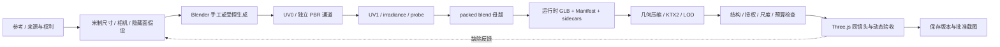

# 05 · 资产制作、烘焙与授权计划

本页为 [E] 制作计划。素材站许可已核查，具体最终资产尚未选定、下载或生成。复杂度用低 / 中 / 高表示工作性质，不是报价或已验证工期。预算统一见 [06](06_Phase_Acceptance.md)。

## 1. 十类资产的最佳路线

| 类别 | 首选生产路线 / 负责工具 | 免费候选来源与许可 | 性能影响 / 复杂度 | 替代路线与适用边界 |
| --- | --- | --- | --- | --- |
| 远山与地形 | Blender 制作 / 侵蚀高度图离线处理 → 分块网格 + normal / snow / slope mask；远峰用低模或分层投影 | 自制地貌；[Poly Haven Alps Field](https://polyhaven.com/a/alps_field) 为 CC0 光色 / 山谷参考，不直接把近处草地全景当模型 | 几何中，远景纹理中；复杂度高，构图决定质量 | 摄影 / Blender 预渲染的远山卡片，限视差；procedural-alpine-lake 无明确许可，不复制算法实现或成片 |
| 湖泊 | 手工确定水域与湖底 → 实时 planar reflection + 受控波场 + 深度吸收；Blender 负责岸床 | 自制 shader；[Three.js Water](https://github.com/mrdoob/three.js) 与 [luminous 波场](https://github.com/stas4000/luminous-lake) 代码 MIT；法线自制或另记 CC0 | 反射额外 pass、透明填充高；复杂度高 | 标准档降反射分辨率 / 场景层；简化体验用离线静帧 / 短视频；禁止以统一透明平面代替近岸 |
| 近景植被 | 选少量针叶物种，Blender 修形叶片 / 树干、烘焙法线、原创多级 LOD；GPU 风动 | [EZ-Tree](https://github.com/dgreenheck/ez-tree) MIT 起点；[Poly Haven Models](https://polyhaven.com/models) CC0 候选；[ambientCG Bark001](https://ambientcg.com/view?id=Bark001) CC0 | alpha-test、阴影、过绘制高；复杂度高 | 用户有权采集的扫描 / 植物图集；无足够质量时缩小可观察范围，而不是用圆锥近树 |
| 远景森林 | 同树骨架生成 LOD，分块 instancing / cluster impostor；Blender 离线生成方向图集 | 自制树派生；EZ-Tree / CC0 资产保留源许可台账 | draw calls 中，图集显存和透明填充中高；复杂度中高 | 超远景林冠投影 / 简化几何，不能在近中景横向滑动 |
| 岩石与苔藓 | Poly Haven CC0 扫描候选 → Blender 减面、保留轮廓、局部法线 / roughness；苔藓以坡向 / 湿度 mask 加少量几何 | [Poly Haven Models](https://polyhaven.com/models)、[ambientCG Surfaces](https://ambientcg.com/list?type=Material) 的 CC0 资源；逐条选型 | 少量 hero 石中，散布可实例化；复杂度中 | 自制石体 sculpt / displacement 后烘焙；不要把贴图苔藓铺满所有石面 |
| 木屋外观 | **Blender 手工母版**，真实原木榫接、门窗、屋檐与基础；生成脚本只辅助重复构件 | 自制模型；Poly Haven / ambientCG CC0 木材、屋面与地表贴图 | 几何中，材质数量易膨胀；复杂度高 | img2threejs 可做比例草案 / 原木参数结构，但正式近景需修形、UV 和美术验收 |
| 木屋内部 | **Blender 完整可编辑母版**，与外壳同场景；UV0 PBR + UV1 irradiance、室内探针与运行时 GLB | 自制；[Poly Haven 木地板](https://polyhaven.com/a/wood_floor_worn) 等 CC0；plugin-interior 仅可选辅助流程 | 光图 / 材质显存高，烘焙与迭代高；复杂度最高 | 备用 B：静态外观烘焙网格；有合法多视角数据才考虑局部 Splat，不能默认单图恢复完整背面 |
| 家具与装饰 | CC0 基础家具 + Blender 改尺寸 / 布局 / 褶皱；主桌椅手动修形，照片与书封用原创空态 | Poly Haven CC0 候选，自制书 / 框 / 杯；不能把“网上免费模型”当授权 | 小物数量与材质数中高；复杂度中 | img2threejs 适合非 hero 小道具；受控区以外用更低 LOD，但可见背面仍要完整 |
| Mac 风格电脑 | Blender 制作原创无标志铝壳笔记本、屏幕独立面与锚点、键盘 / 铰链；DOM 负责可读内容 | 自制；可研究 pmndrs 示例代码 MIT，不直接采用来源不明 laptop GLB / Apple 素材 | 近景几何中，屏幕 / 玻璃叠层中；复杂度中高 | 远景低模 + 同状态原创预览；纹理键盘可替代逐键几何但不能损伤 S04 |
| 环境音效 | 合法 CC0 环境声筛选 / 自录 → 剪辑无缝环、低通 / 音量组、手势解锁 | [Freesound](https://freesound.org/) **每条单独筛 CC0**；[FAQ](https://freesound.org/help/faq/) 显示站内存在多种许可；自录需相应权利 | 下载中，长音频解码内存可能高；复杂度中 | 首版仅一条轻环境底声；也可自制合成风 / 水；无许可时静音，不用他人电影音轨 |

素材站资源供给和物种适配度不等于已选齐所有模型。Phase 01 须先确认 1–2 棵 hero 针叶树、2–3 块 hero 石与一种原木材质能达到 S01/S02，才扩充资产库。

## 2. 工具职责：避免自动生成替代美术制作

| 工具 | 本项目允许的职责 | 不作为保证的能力 |
| --- | --- | --- |
| img2threejs 主项目 | 道具 / 参数结构提案，层级、pivot、代码形体试验 | 不保证一张小屋照片生成可用的完整建筑、室内、UV 与烘焙 |
| img2 Interior | 可选的单房间 scene-specific authoring、比较 / gate、Blender 导出经验；按复制路径审查许可 | 不保证准确恢复隐藏结构，不把 README 原生渲染当浏览器帧，不无条件复制受限 runtime |
| Blender | 建筑权威母版、尺寸、拓扑、UV、PBR、照明、烘焙、LOD / 碰撞代理与相机 | 本地渲染漂亮不等于导出后已通过浏览器验收 |
| glTF Transform / KTX | 可重复的压缩、量化、重排和纹理编码；生成独立产物 | 文件更小不保证显存更小或画质无损，不自动生成艺术合格 LOD |
| SuperSplat / Spark | B 路线的编辑与 Three.js 运行时，严格区分职责 | 不从单图自动训练完整环境，不提供完整 PBR 重光照 |

[F] 工具及许可证的固定版本证据见 [03](03_Open_Source_Research.md)。不在本轮安装 Blender / bpy / npm 工具或启动生产。

## 3. 可重复的 Asset Pipeline



每个环节需保留输入 / 输出 hash、工具版本与参数。变更母版后，受影响的 bake、LOD、probe、碰撞、路径和浏览器截图全部标 stale，不能拿旧 screenshot 证明新版本通过。

### 3.1 参考到结构

先拆分可见证据和猜测：平面、净高、门窗、构件连接、相机焦距、光源与材质。单图中遮住的区域标 [H]，依据真实构造补建；如影响路径或比例，补多视角设计，而不是用贴参考图的平面遮住。将 S01–S04 反推出来的“必须可见区域”写入建模范围。

参考重建准确度分三层：

1. 原视角：先匹配相机 / 投影 / 裁切，再看轮廓、门窗和主要家具关键点；工程初始线为重要边界误差约 ≤图像宽 2%，需结合来源质量校准。
2. 侧面 / 反面：至少两侧、背面和三个窗 / 门角度，检查体积、连接、尺度与穿插。原视角 SSIM / IoU 高不能代替这个检查。
3. 实际浏览器：相同 pose、aspect、显示变换下与 Blender 对照，同时分开诊断 normal、roughness、direct、indirect 和最终合成。自动分数只提示差异，人工审美决定是否可信。

参考为想象设计图时，不以物理测绘准确率表述结果；本项目允许艺术重构，但用户须批准统一设计。

### 3.2 建模和材质

统一单位、坐标、命名、transform 与 texel density。原木端纹和侧纹独立，墙 / 地板贴图按真实面积重复，hero 接近区域保留倒角和轮廓细节；少量随机颜色 / UV 变化不能破坏物种和材质一致性。

UV0 为 PBR；UV1 对应 glTF TEXCOORD_1，用于无重叠 lightmap atlas。不同摆放的共享几何需要不同光图区域或独立烘焙策略，不能盲实例化同一 UV1 让桌腿和墙互相串光。为 mip / 压缩留 padding（2K 起点 8–16px，按最小 mip 与采样验证）；重要薄件分配足够像素，避免小物光图塌缩。

不把 baked AO 强乘进 BaseColor；AO 与 lightmap 的遮蔽贡献需校准，防止墙角发黑。normal 使用 glTF / OpenGL 约定，导入 DirectX normal 时明确转换绿色通道。必要切线在导出前后对照，透明叶片的 alpha 覆盖和双面策略要独立验收。

### 3.3 烘焙合同

运行时交付保留可重用 PBR，静态 irradiance 不乘 albedo，太阳 direct 与运行时阴影分开。建议分别烘焙天空 diffuse（direct + indirect）和固定太阳 indirect，再合成；运行时防止天空 diffuse 重复累计，同时保留 specular。若这种材质适配未通过机制验证，先采用校准后的 SUN-free ambient + runtime SUN，承认太阳反弹不足的限制。SUN-free 本身不消除运行时重复天空 diffuse；回退也须通过能量校准，否则停止整屋烘焙或比较 B1。细节见 02。

探针选择同一太阳 / 天空方案。若 lighting HDRI 自带强太阳盘，还叠加独立 SUN，会有能量和高光重复风险；制作 sunless lighting probe，显示天空中的太阳与 real SUN 对齐，并在金属球 / 水面校准。室内探针不能用一张户外天空球代替局部木梁和墙面的反射。

EXR 保存线性高动态数据；是否用 LinearSRGBColorSpace 或自定义数据解释，由锁定 Loader / shader 合同决定，禁止额外 sRGB 解码。先做四色块与灰卡光图方向测试，确认 UV1、翻行、强度 / PI 标定再烘整屋。插件某版本的 EXR 翻行实现只作为发现边界问题的证据。[源流程](https://github.com/img2threejs/plugin-interior/blob/f2c3667bb6d3bacfc9e38898a7516d47bc2e90b1/reference/bake-export.md)。Blender baking 可区分 Color / Direct / Indirect，参考 [官方技术说明](https://code.blender.org/2014/02/cycles-baking/)；新版本设置仍以实际锁定版本实验为准。

开门、换家具或大幅拉窗帘会改变 GI。首版锁太阳和主要布局；小幅窗帘动态只作为近似，不承诺 GI 随动。大改布局必须重新烘焙全部受影响 atlas / probe，不只更新可见的一张贴图。

### 3.4 导出与压缩

交付三类产物：

- `room-master.blend`：packed 可编辑母版、命名相机 / 光源、完整 PBR / UV 与源资源台账。
- runtime GLB + lightmap / probe / scene manifest：Three.js 正式输入，保留门、屏幕、热点和碰撞锚点。光图绑定由 sidecar 声明，不假设任意 GLB 查看器自动理解自定义 lightmap。
- 可选 static portable GLB：把完整静态外观烘进去用于审阅，清楚标注不等价于 runtime，不允许又加一遍光照。

压缩顺序：结构审计 → 保留命名与锚点的合并 / 剔除 → 合理 LOD / 减面 → 量化与 Meshopt（或经过比较选择 Draco，不重复叠两种同类压缩）→ 纹理 KTX2 → 浏览器复验。几何压缩主要减下载和缓冲体积，**不等于降低 draw calls 或三角形数量**。

颜色可从 ETC1S 起测，normal / roughness / alpha 和近景细节优先 UASTC 等更合适质量设置；线性 HDR lightmap 不直接当普通 LDR JPEG 压缩，需比较 half-float EXR 与经过验证的编码方案。不要在正式基线前引入未经校准的 RGBM / 新 HDR 扩展。

[F] [glTF Transform meshopt 源码](https://github.com/donmccurdy/glTF-Transform/blob/8e2a94a2616d293c4b503d0fb6a4b42e6ec7c62f/packages/functions/src/meshopt.ts) 及 [KTX2Loader](https://github.com/mrdoob/three.js/blob/fae873455dff9602a916b4d2e8a985921448b62a/examples/jsm/loaders/KTX2Loader.js) 可核查相关接口。压缩后重查 UV1、法线、切线、alpha、屏幕 UV、bounds、动画 / 交互节点和像素差。生产依赖从稳定版本锁定，不能直接照搬 dev HEAD。

## 4. Manifest 与目录合同

以下仅是未来文件结构 / schema，当前不创建网站或模型。

```text
assets-src/          # blend / 源材质 / 拍摄来源，仅本地生产
assets-runtime/     # 分区 GLB、KTX2、光图、probe、碰撞代理
asset-manifest.json # hash / bounds / tiers / dependencies / readiness
licenses/           # 每个代码与资产的适用条款、NOTICE
art-evidence/       # 同镜头截图、工具配置、审美批准记录
```

每项记录：assetId、sourceURL、creator、licenseId、licenseURL、retrievedAt、sourceHash、modifiedBy / modifications、sourceRevision、exporterVersion、runtimeHash、scale / bounds、triangles、materialCount、纹理尺寸 / 格式 / 色彩、UV 通道、字节数、预计 GPU bytes、LOD 关系、collision / screen anchors、loaded owners。

授权审批分层：已明确许可且与用途相容 → 可进入后续生产；无项目许可 / 不明模型 → 研究参考，禁止进入构建 Manifest；CC BY → 必须保留具体作者与署名位置；CC BY-NC / 编辑用途专用 → 不作为通用正式网站资产。许可缺失是资产入库阻断项，不靠仓库 star 数或下载按钮解决。

Poly Haven 与 ambientCG 的 CC0 依据分别见 [官方许可](https://polyhaven.com/license)、[官方许可](https://docs.ambientcg.com/license/)。若实际调用 [Poly Haven API](https://github.com/Poly-Haven/Public-API/blob/master/ToS.md)，按其独立条款记录调用身份 / 来源标注；最终自托管已下载资产。

## 5. 资产预算如何落地

近景纹理 / atlas 优先，远景不使用和近景同级别贴图。每个 draw pass 都计预算；树叶透明覆盖、阴影、反射不能只看主视图多边形数。真正的分配需要 Phase 01 的 hero 资产在目标镜头实测，而不是先下载几十 GB 的高模资源。

至少记录下载大小与 GPU 估算两个数。例如一张 RGBA8 4096² 贴图约 64MiB，无压缩完整 mip 约 85.3MiB；4MiB 的网络压缩文件不代表只占 4MiB 显存。2048² RGBA16F 约 32MiB，完整 mip 约 42.7MiB；三个这样的 lightmap atlas 约 128MiB，尚未含其他贴图、几何与 framebuffer。KTX2 的实际转码格式随设备变化，按真实 block 格式计。

若预算不足，先减不可见面、材质切换、远林、反射代理和无意义大图，保住近景树轮廓 / 岸线 / 原木质感。不能以“优化”为理由把已批准的 hero asset 全部换成明显低模；无法同时达标则按 07 执行路线 / 观察范围复议。

## 6. 交付前逐项验收

资产自动检查：文件存在与 hash、来源许可完整、米制 bounds 合理、命名锚点不丢、UV1 无重叠 / 无亚像素塌缩、纹理通道 / 色彩明确、包体 / atlas 预算、GLB 可解析、碰撞代理闭合与路径版本匹配。

人工检查：同镜头原生 / 浏览器对照、多角度、近裁切、反射 / 阴影 / normal、远近 LOD 运动片段。结构测试通过不代表艺术通过；只有用户 / 美术负责人批准，资产状态才能由 candidate 变为 approved。
