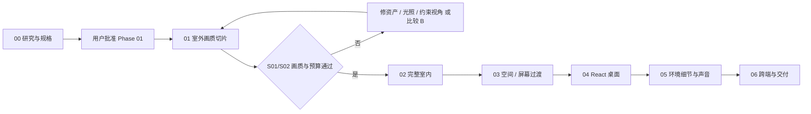

# 06 · 分阶段实施、性能测量与验收

**当前仅 Phase 00 获准。** 后面阶段是可执行计划，所有代码、模型、性能和视觉验收仍未实施。[E] 表格中的门槛为初始工程目标；[H] 是否可达必须用指定设备 / 真实资产验证，不承诺未测 FPS。

## 1. 阶段依赖与止损

每阶段交付可复现的原始证据，不用构建成功替代视觉批准。任何阶段变更太阳、建筑、镜头或核心材质都可能使此前视觉证据失效，须重测受影响镜头。除 Phase 01 的授权需要用户明确批准外，后续是否逐阶段授权由用户安排，本轮不推定已有任何开发权限。

## 2. Phase 00 · 研究、架构、视觉规格（本轮）

| 项目 | 具体要求 |
| --- | --- |
| 目标 | 排除错误路线，形成有源码证据、可执行的美术 / 工程合同 |
| 前置条件 | 读取完整任务；确认工作区安全位置；只读联网研究权限 |
| 技术任务 | 指定仓库及拓展仓库的 README / 源码 / LICENSE；区分离线 / WebGL / WebGPU；核查 Demo；比较 A/B；定义持久 Canvas、状态、路由和资源生命周期 |
| 依赖资源 | GitHub、Three.js / React / 资产站官方资料；不依赖 npm / Blender 安装 |
| 交付物 | 七份 Markdown + 根 README；固定源码证据、五镜头、十类资产、Phase 00–06、风险与自我反驳 |
| 自动化检查 | 文件数量 / 非空 / 相对链接 / reference link / 代码路径 / Mermaid fence 配对；源码固定链接对照实际读取的 manifest；交付包与源文档逐字节一致 |
| 人工视觉验收 | 01 / 04 的画面规格是否具体且一致；Demo 观感与源码结论是否分开；未生成正式画面，因此没有本项目画质通过结论 |
| 失败条件 | 任一指定项目被忽略；离线 renderer 被称为网页引擎；许可推断错误；声称未测性能；擅自开发 / 部署 |
| 回退方案 | 补证据 / 改结论；访问失败明确记录并设后续验证；不能用不真实的确定性填空 |

完成本轮文档后停止，等待批准 Phase 01。

## 3. Phase 01 · 湖岸与木屋外部写实画质验证

| 项目 | 具体要求 |
| --- | --- |
| 目标 | 证明 S01 / S02 在浏览器内同时具备照片感、运动稳定性和可接受预算；优先证伪首选 A |
| 前置条件 | 用户批准；锁定参考与基础硬件 / 网络；选定少量合法 hero 资产；01 / 04 的外壳与门窗关系确认 |
| 技术任务 | 最小 TS / React / Three.js 工程和单 Canvas；固定太阳 / 色彩；湖岸地形、实时湖面、1–2 物种树、2–3 hero 石、完整外壳；有限观察和接近路径；planar 反射 / 近岸光学；基础 LOD、GPU readiness、性能计数、错误降级；小型中性灰卡 / 金属球 / 四色 UV 光图校准件，禁止扩成完整室内 |
| 依赖资源 | 合法 CC0 树 / 石 / 原木材质，Blender 母版基础、天空与反射代理；GLTF / KTX2 解码器；不需要真实个人内容 |
| 交付物 | S01 / S02 原始截图 + 观察边界截图 + 运动片段；冷 / 热缓存性能记录；资源 / 许可 manifest；A 的可行或不通过结论；必要时同镜头 B 对照片段 |
| 自动化测试 | renderer 能力 / fallback；必要资源缺失 / 解码错误；路径采样无碰撞；重复点击只留一个 transition；25/50/75% 取消；光图方向 / 强度校准；统计 all-pass calls 与 triangles、资源预算；shader 错误为零 |
| 人工视觉验收 | 01 的五项各 ≥4/5；S01/S02 无圆锥近树、镜面湖、岸线白边、木纹巨大、漂浮、显著 LOD pop；不同观察点仍成立；原始网页画面不可修图 |
| 失败条件 | 任一核心视觉项不通过；受支持基准设备标准档 p95 ≥33ms 或均值长期 <50FPS 且可见卡顿；低档只能通过破坏 hero 质量达标；只有静止帧漂亮；进入路径暴露卡片假景 |
| 回退方案 | 优先修比例 / 光照 / 资产；降低非核心远林、反射负担、约束镜头；若两轮有因果记录的修复仍失败，暂停扩功能，按 07 在同镜头比较离线远景 / 外观烘焙 B。不能自动改成完全不可探索的视频 |

**明确执行顺序**：先灰模验证构图 / 尺度与相机通道 → 导入接近最终质量的 hero 资产 → 统一太阳 / 色彩与水岸 → 检查静止及运动 → 受控性能采样 → 定位失败 → 修复一次后复测 → 给出 go / rework / compare-B 决策。灰模通过不准提前做 Dock 或大量外围应用。

**可进入 Phase 02 的证据**：用户 / 美术负责人批准 S01/S02；目标设备记录可复现且满足目标或有明确经用户接受的修订指标；光照 / 导出机制没有悬而未决的错误；未授权资产为零。主张“照片感”必须同时拿出运动片段。

## 4. Phase 02 · 完整木屋内部

| 项目 | 具体要求 |
| --- | --- |
| 目标 | S03、S04 所需的完整可见室内，保持与外壳、窗外世界一致 |
| 前置条件 | Phase 01 通过；同一建筑母版、太阳和光图合同锁定；确认室内参考 / 隐藏结构假设 |
| 技术任务 | 房壳、木梁、窗 / 门厚度、家具、书 / 框等占位道具、原创电脑；PBR / UV1 / irradiance / 室内 probe；runtime GLB 与 sidecar；分包预载；室内站位与碰撞代理；小范围风动对象与静态 GI 边界 |
| 依赖资源 | Blender / 选定可选 authoring 工具；CC0 材质家具；光图校准结果；合法原创电脑外观 |
| 交付物 | packed blend、runtime GLB + manifest、必要光图 / probe、许可表；S03/S04 原生 / 网页同镜头与侧背面；室内加载峰值记录 |
| 自动化测试 | 门窗 / 屏幕锚点一致；UV1 无重叠 / 塌缩；GLB parse / sidecar/hash；atlas、纹理和场景预算；室外窗口依赖未被错误卸载；文件缺失降级 |
| 人工视觉验收 | 室内尺度可信，木纹 / 布料 / 金属可辨；无光图接缝、漏光、双重阴影、全白窗；转头和近桌仍成立；S03/S04 各项 ≥4/5 |
| 失败条件 | 只复原参考正面、侧背面破碎；光图 UV / 强度 / 色彩错误；所有物体同 roughness；最终模型只能在 Blender 好看；内外不相容 |
| 回退方案 | 回到母版 / 烘焙环节修因果；简化非主角道具；必要时固定布局的 B 外观烘焙，但保留交互电脑和共同世界坐标；不以插件 gate 的分数替代人工批准 |

## 5. Phase 03 · 室外、室内与屏幕过渡

| 项目 | 具体要求 |
| --- | --- |
| 目标 | 从湖岸到桌面预览的连续、可逆、可恢复导航；先解决 ScreenBridge，再扩桌面应用 |
| 前置条件 | Phase 01/02 画质通过，所有锚点和空间尺度稳定，目标资产可预载 |
| 技术任务 | ExperienceMachine / CameraDirector、弧长与速度曲线、门框揭示、look / FOV、输入所有权；readiness guard、transition token、SafeNode；屏幕四角投影、单一 DesktopRoot、布局展开、反向恢复；暴露浏览器内容路径 |
| 依赖资源 | 批准相机 manifest、门洞碰撞 / ScreenAnchor、稳定字体 / 预览、室内外最低质量资源 |
| 交付物 | S01→S05 占位桌面→S03→S01 的完整录屏；屏幕误差表；中断 / 加载错误矩阵；刷新与路由恢复合同 |
| 自动化测试 | 各转场 0/25/50/75/100% 取消；重复点击 / Back / resize / hidden-resume / contextlost；旧 Promise 不提交状态；相机无并发写入；单 Canvas / 单桌面根；屏幕角点 ≤2 CSS px；输入解锁只在 ready 后发生 |
| 人工视觉验收 | 无突兀跳切、近裁穿模、窗外换景、曝光突变、屏幕双影、字体模糊和拉伸；Reduced Motion 无长飞行；反向退出同样完整 |
| 失败条件 | 屏幕映射只能在一种宽高比成立；关闭桌面丢状态；context 重建后位置错；中断把镜头瞬移到终点；通过黑屏隐藏加载 |
| 回退方案 | 屏幕正面姿态 + 同色短淡入 / 遮罩展开；门框阶段固定安全姿态等待资源；仍保留可逆 / 状态恢复和清楚的运动语义，不把全屏透明切换描述为像素级无缝 |

## 6. Phase 04 · React 桌面

| 项目 | 具体要求 |
| --- | --- |
| 目标 | 四个应用空态可用，空间入口与内容路由统一；不填用户真实资料 |
| 前置条件 | Phase 03 ScreenBridge / return snapshot 通过；AppRegistry 与内容 schema 确定 |
| 技术任务 | 原创 Dock / 图标 / 壁纸；WindowManager、焦点 / z-order / rect；Notes、Photos、Projects、Resume 空态；lazy app / error boundary / lifecycle；direct route / canonical / 静态正文模板 / History；会话布局和滚动恢复；手机单窗口 |
| 依赖资源 | 经审查的 MIT 代码、原创视觉资源、静态内容 manifest；不依赖天气 / 联系表单 / 外部代理服务 |
| 交付物 | 四应用、窗口管理、可分享内容结构、完整返回三维流程、键盘 / 触屏测试记录 |
| 自动化测试 | 打开 / 关闭 / 最小化 / 最大化 / 恢复 / 焦点；viewport resize 后窗口在屏内；存储禁用 / 损坏；路由直达 / 刷新 / Back / Forward；最小化应用计时器暂停；卸载监听器清理；无 JS / 无 WebGL 仍可访问正文空态 |
| 人工视觉验收 | S05 的阅读层次和文字清晰；Dock 不遮正文；键盘焦点可见；从打开应用返回木屋再回来，窗口内容 / rect / 滚动一致；手机不缩成微型桌面 |
| 失败条件 | 桌面只是截图或所有内容藏在 Canvas；伪 permalink；Back 跳出本站；复制 Apple 未授权素材；桌面应用一报错整场景白屏 |
| 回退方案 | 缩减桌面装饰与窗口特效；移动端先保留全屏应用切换；同数据源直接内容页始终可用；不增加外围系统功能拖延核心验收 |

## 7. Phase 05 · 视觉、环境、声音与细节

| 项目 | 具体要求 |
| --- | --- |
| 目标 | 在已成立的画面中补生活感与微动态，不改变核心构图和性能等级 |
| 前置条件 | 00–04 的关键验收通过，有主镜头前后对照与资源余量 |
| 技术任务 | 精修原木 / 苔藓 / 织物 / 键盘，近景不规则与自然湿度；统一风；细微水波 / 远云；环境声、门 / 室内低通、静音持久化；谨慎添加景深和小幅后期 |
| 依赖资源 | CC0 / 自录音频、批准材质、真实 browser baseline；不用未知电影音轨 |
| 交付物 | 五镜头最终美术版、无声 / 有声交互片段、素材来源表、对照性能报告 |
| 自动化测试 | 声音需手势解锁；mute / unmute / 隐藏恢复；Reduced Motion 关闭微动；资源重复进入无增长；后期 on/off 对照；预算回归 |
| 人工视觉验收 | 动态不抢主角，循环无明显接缝，风场一致、影子不漂；无 Bloom 洗白 / 强 DOF 糊文字；音量温和且无突然播放 |
| 失败条件 | 新特效让均值 / p95 不达标；靠雾掩盖模型；水和树像同步正弦机械摆动；声音未授权或静音不可靠 |
| 回退方案 | 按对照证据移除 / 降频装饰项，保留已批准的基础资产和光照；优先稳定画面而非增加效果数量 |

## 8. Phase 06 · 性能、跨端与交付

| 项目 | 具体要求 |
| --- | --- |
| 目标 | 验证完整体验、内容访问、长时间稳定和可维护交付；部署须另获授权 |
| 前置条件 | 五镜头和内容 / 导航通过；明确支持矩阵与许可；所有资源版本锁定 |
| 技术任务 | 三档与能力检测、加载失败 / contextlost；Safari / Chromium / Firefox、iOS / Android；touch / keyboard / a11y；长时间与网络压力；build / route headers / caching；content SEO / sitemap；清理 / LICENSE / 文档 / 回滚包 |
| 依赖资源 | 基准 Mac / Windows / 手机实机、浏览器版本和网络条件、合法资产、批准的发布环境 |
| 交付物 | 验收报告、性能 CSV / JSON、资源 hash / 台账、运行与构建说明、问题清单、回滚版本；公开部署是独立授权动作，本轮不做 |
| 自动化测试 | type / build、状态机 / 路由 / 资源回收；桌面与移动浏览器 E2E；404 / 解码失败 / context restore；20 次往返、30 分钟压力；断网内容回退；链接与 canonical；依赖许可清单 |
| 人工视觉验收 | 五镜头各平台抽检、玻璃 / 水 / 叶片 / lightmap 差异；触屏与 Reduced Motion；手机内容可读；最终版本无明显回归 |
| 失败条件 | 任何支持平台打不开内容；持续显存增长或重复 context loss；冷启动无法到安全状态；许可不完整；视频或 poster 被当作完整 3D 测试成绩 |
| 回退方案 | 按浏览器能力分发经验证的标准档 / 简化内容；修复后重测相关范围；冻结稳定版本 / 回滚；不以“在开发机可以”交付 |

## 9. 质量档与初始资源预算

以下均为 [E] 预警线，**不是测量结果**，Phase 01 用真实资产调整。MiB=2²⁰ bytes。GPU 数值为按资源格式估算的分配上限，浏览器不能统一提供精确全局显存读数。

| 项目 | 高画质（桌面） | 标准（默认起点） | 简化体验 |
| --- | --- | --- | --- |
| 输出与 DPR | 1440×900 CSS；DPR cap 1.5，按实际 framebuffer 记录 | 同 CSS；DPR cap 1.0–1.25 | 先保证 DOM / poster；可选小型 3D 时 DPR 1 |
| 主视图 draw calls | ≤200 | ≤120 | 可选 3D ≤60 |
| 所有 pass 合计 calls | ≤450 | ≤260 | 可选 3D ≤100 |
| 主视图三角形 | ≤1.5M | ≤0.75M | 可选 3D ≤0.25M |
| 所有 pass 三角形 | ≤3M | ≤1.5M | 可选 3D ≤0.4M |
| 驻留纹理估算 | ≤384MiB | ≤192MiB | 可选 3D ≤64MiB |
| RenderTargets / depth / 后期 | ≤128MiB | ≤64MiB | ≤24MiB（有 3D 时） |
| GPU 资源总估算 | ≤768MiB | ≤512MiB | ≤128MiB（有 3D 时） |
| 水反射起点 | 1024²，简化反射层，可调更新 | 512²，降频并看运动伪影 | 静态 probe / poster；交互近景不足则直接内容 |
| 初次可交互外景累计下载 | ≤25MiB | ≤12MiB | 内容 shell / poster 初始 ≤1MiB |
| 完整外景下载 | ≤35MiB | ≤22MiB | 按需，可不加载 3D |
| 室内新增下载 | ≤25MiB | ≤15MiB | 应用内容按需 |

P0 HTML / 关键代码 / 图标等压缩传输目标 ≤0.8MiB，poster 约 ≤250KiB，包含在对应初始包预算中；纹理还需留入场峰值余量，不能高低 LOD 同时常驻超标。Photos 原图不计进 3D 预载包，需独立按需预算。

高画质不是必须把 DPR 设为 2；1440×900 DPR 2 有 4 倍 CSS 像素，须独立记录。几何 / calls 达标也可能被透明叶片、反射、光图、内存带宽拖慢；这些预警线不能当性能保证。

初始自适应策略：标准档启动，能力与实际 headroom 支持后允许高档；连续约 3 秒 p95>33ms 先降 DPR / 反射层再降非核心远景。连续约 5 秒仍 >50ms，转简化路径并清楚说明；升档至少 15 秒稳定余量和 cooldown，避免反复切档。手动锁定画质尊重用户选择，资源不足 / context loss 需要明确降级反馈。具体阈值通过 01 调整，不依赖 UA 字符串断言设备快慢。

## 10. 测量方法与复现规程

### 10.1 基准矩阵

必须由用户确认至少一个最低支持桌面：建议一台 Apple Silicon 集显 Mac（Safari / Chromium）和一台 Windows 中档独显或集显（Chromium / Firefox）。记录型号、GPU、内存、OS / 浏览器完整版本、屏幕刷新率、电源模式、温度 / 其他负载情况。未知设备不能标成“全部桌面通过”。手机至少 iOS Safari、Android Chromium 各一台，首要门槛是内容和简化模式可用。

每组固定 1440×900 CSS、明确 DPR、drawing-buffer 宽高、质量档、资源 hash、太阳 / 相机。高 DPI 与 1920×1080 作为额外测试，不能与基准混算。自动化 headless 适合逻辑回归，GPU 帧率结论用有真实硬件加速的可见浏览器复核。

每条场景采样建议预热 10 秒、正式 60 秒、重复 3 次，分别覆盖 S01 idle 微动、观察边界移动、S02 全路径、门口同时驻留峰值、S03 转头、S04 交接、S05 窗口操作。短路径反复播放需保存每次边界，不把复位跳变计作正常路径。冷启动与首次 shader / 解码卡顿单列，同时保留用户看到的端到端耗时。

### 10.2 指标、工具、口径与失败线

| 指标 | 采样方法与口径 | 初始验收目标 |
| --- | --- | --- |
| FPS / frame time | 原始 rAF timestamp 差与渲染标记；均值 FPS 用有效帧数 / 有效时间；排序求 p50 / p95 / p99、>33 / >50ms 比例。rAF 是调度 / 更新节奏，不是硬件呈现时间的精确测量 | 桌面主路径均值尽量 50–60FPS；p95<33ms；同时查看肉眼卡顿和 p99 |
| CPU / GPU 时间 | 浏览器 Performance trace 看主线程、GC、解码与上传；GPU timer extension 支持时异步采样并排除 disjoint，不调用同步 finish | 区分 CPU / GPU 瓶颈；没有 timer 就记录 N/A，不能用 CPU render 提交时间冒充 GPU 耗时 |
| Draw calls / triangles | renderer.info，手动 reset 每个实际渲染帧一次、autoReset=false 汇总主相机 / reflection / shadow / 后期；同时列主视图与全 pass | 不超本页预警线；避免只报静止单 pass 最小值 |
| 纹理 / GPU 估算 | Manifest 尺寸 × 实际像素 / block 格式 × mip × 层 / 面；加 render targets、depth、几何 buffer；renderer.info.memory 是数量而非 bytes | 符合驻留与峰值预算；同一 decoder / 环境缓存去重，记录不可测 overhead |
| 下载量 | build 产物 manifest + Network / Resource Timing encoded / transfer / decoded；冷缓存和暖缓存分别测 | 标准首个外景 ≤12MiB；完整外景 / 室内按表；跨域无 TAO 数据记未知，不当 0 |
| 加载时间 | performance marks：navigation→poster、first content、first interactive world、room GPU ready、desktop interactive；网络 / 解码 / GPU 分段 | 20Mbps / RTT150ms 冷缓存目标 poster≤2s、标准外景可交互≤8s；进入室内意图若未预载，约 3s 内到就绪或明确进度 / 内容回退。均为待验证目标 |
| 交互延迟 | pointer / keyboard event→下一可见响应的 marks / 录屏；区分 hover / click反馈与 7–10s 的设计飞行时长 | 反馈 p95≤100ms；资源 ready 时进入导航状态约≤200ms；窗口交互无持续主线程长任务 |
| 浏览器错误 | console、unhandledrejection、WebGL shader / context、fetch / decode / audio / image 错误分类和恢复记录 | 未处理异常 / shader 错误为 0；故障注入产生的已处理错误另计，须恢复或内容可用 |
| 稳定性 | 20 次室外→室内→桌面→返回，加 30 分钟运行；在第 5 / 10 / 20 次相同安全点记录资源计数 / 估算与趋势 | 缓存预热后进入平台期；第 20 次不比第 5 次同状态估算增长 >10% 且无解释；连续单调增长即调查，不因未超 10% 忽略泄漏 |

**禁止**：为了降 p95 删除 >100ms 的活跃帧；simulation dt clamp 可以保护运动，但性能记录保留原始时间。只排除明确的页面隐藏、用户暂停和 DOM-only 不渲染区间，并记录排除理由。暖缓存 / 预编译成绩不能掩盖冷启动的可见卡顿。

[F] [PerformanceResourceTiming](https://developer.mozilla.org/en-US/docs/Web/API/PerformanceResourceTiming) 提供资源时序；[WebGLRenderer 文档](https://threejs.org/docs/pages/WebGLRenderer) 提供 renderer.info 等计数入口。计数 / bytes / GPU timing 的区别是本项目测量合同，不能互相替代。

### 10.3 故障与压力矩阵

每个关键转场至少覆盖：网络慢 / 断开 / 某包404、纹理解码失败、shader失败、AudioContext锁定、存储不可用、连续点击、Escape、Back / Forward、刷新、视口变化、页面隐藏恢复、WebGL 不可用、context lost / restore。通过标准是目的地安全或明确保留安全节点、资源不泄漏、内容入口可用；不是要求所有故障下继续播放电影。

## 11. 验收报告格式

每次记录 scene / build revision、设备与质量档、资源 hash、操作脚本、冷暖缓存、网络设置、有效与排除区间、各指标原始数据、截图 / 视频、人工评分、缺陷 / 决策。状态限定为 PASS / REWORK / BLOCKED_BY_EVIDENCE / NOT_RUN，必须说明是否真的执行。

**本轮真实状态**：源码与文档研究已执行；若干在线 Demo 已体验；本项目所有原型、渲染、性能、自动化应用测试、模型和部署均为 NOT_RUN。文档检查不等于 Three.js 体验通过。
